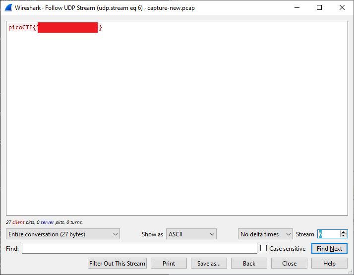

# shark on wire 1

- [Challenge information](#challenge-information)
- [Solution](#solution)
- [References](#references)

## Challenge information

```text
Level: Medium
Tags: picoCTF 2019, Forensics
Meta Tags: Walkthrough, Walk-through, Write-up, Writeup
Author: DANNY
 
Description:
We found this packet capture. Recover the flag.

Hints:
1. Try using a tool like Wireshark
2. What are streams?
```

Challenge link: [https://learn.cylabacademy.org/library/30](https://learn.cylabacademy.org/library/30)

## Solution

Open up the PCAP-file in [Wireshark](https://www.wireshark.org/).

The second hint suggests we should look for streams but before that let's get an overview of the contents with `Protocol Hierarchy Statistics`.

### Get Protocol Hierarchy Statistics

In the GUI-version this can be found in the `Statistics` menu and then `Protocol Hierarchy`.

Alternatively, you can use the commandline [tshark](https://www.wireshark.org/docs/man-pages/tshark.html) version like this:

```bash
┌──(kali㉿kali)-[/mnt/…/picoCTF/picoCTF_2019/Forensics/Shark_on_wire_1]
└─$ tshark -q -z io,phs -r capture.pcap 

===================================================================
Protocol Hierarchy Statistics
Filter: 

eth                                      frames:2317 bytes:202359
  ip                                     frames:1230 bytes:113479
    udp                                  frames:1140 bytes:107983
      ssdp                               frames:128 bytes:27137
      nbdgm                              frames:7 bytes:1731
        smb                              frames:7 bytes:1731
          mailslot                       frames:7 bytes:1731
            browser                      frames:7 bytes:1731
      llmnr                              frames:205 bytes:13924
      data                               frames:749 bytes:60996
      _ws.malformed                      frames:4 bytes:240
      mdns                               frames:47 bytes:3955
    tcp                                  frames:22 bytes:1408
    igmp                                 frames:68 bytes:4088
  ipv6                                   frames:347 bytes:44534
    udp                                  frames:280 bytes:38424
      llmnr                              frames:205 bytes:18024
      mdns                               frames:47 bytes:4895
      ssdp                               frames:7 bytes:1099
      data                               frames:21 bytes:14406
    icmpv6                               frames:67 bytes:6110
  arp                                    frames:738 bytes:44226
  lldp                                   frames:2 bytes:120
===================================================================
```

We see that there are both IPv4 and IPv6 traffic and more UDP than TCP traffic for IPv4.

### Follow UDP streams

Let's follow the UDP streams and look for the flag.

In the GUI, right-click on any UDP-packet and then select `Follow -> UDP Stream`.  

In the new window we see the stream content displayed in the same sequence as it appeared on the network. Non-printable characters are replaced by dots. Traffic from the client to the server is colored **red**, while traffic from the server to the client is colored **blue**.

Down in the lower right corner of the window you can step through the streams by increasing or decreasing the stream number.  
Stream #6 contains the flag.



We can also do this in `tshark` with a bit of command-line kung-fu.

First, we follow UDP-stream #6 and set the output format to `raw`.

```bash
┌──(kali㉿kali)-[/mnt/…/picoCTF/picoCTF_2019/Forensics/Shark_on_wire_1]
└─$ tshark -q -z "follow,udp,raw,6" -r capture.pcap   

===================================================================
Follow: udp,raw
Filter: udp.stream eq 6
Node 0: 10.0.0.2:5000
Node 1: 10.0.0.12:8888
70
69
63
6f
43
54
46
7b
53
74
61
54
33
31
33
35
35
5f
36
33
36
66
36
65
36
65
7d
===================================================================
```

Then we `grep` the hexadecimal flag values only with a [regular expressionj](https://en.wikipedia.org/wiki/Regular_expression).

```bash
┌──(kali㉿kali)-[/mnt/…/picoCTF/picoCTF_2019/Forensics/Shark_on_wire_1]
└─$ tshark -q -z "follow,udp,raw,6" -r capture.pcap | grep -E '^[0-9a-f]{2}$'
70
69
63
6f
43
54
46
7b
53
74
61
54
33
31
33
35
35
5f
36
33
36
66
36
65
36
65
7d
```

And finally, we convert the hex values to ASCII with `xxd`.

```bash
┌──(kali㉿kali)-[/mnt/…/picoCTF/picoCTF_2019/Forensics/Shark_on_wire_1]
└─$ tshark -q -z "follow,udp,raw,6" -r capture.pcap | grep -E '^[0-9a-f]{2}$' | xxd -r -p
picoCTF{<REDACTED>}
```

For additional information, please see the references below.

## References

- [grep - Linux manual page](https://man7.org/linux/man-pages/man1/grep.1.html)
- [pcap - Wikipedia](https://en.wikipedia.org/wiki/Pcap)
- [Regular expression - Wikipedia](https://en.wikipedia.org/wiki/Regular_expression)
- [Wireshark - Documentation](https://gitlab.com/wireshark/wireshark/-/wikis/home)
- [Wireshark - Homepage](https://www.wireshark.org/)
- [Wireshark - tshark](https://www.wireshark.org/docs/man-pages/tshark.html)
- [Wireshark - Wikipedia](https://en.wikipedia.org/wiki/Wireshark)
- [xxd - Linux manual page](https://linux.die.net/man/1/xxd)
