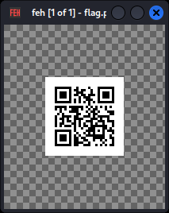
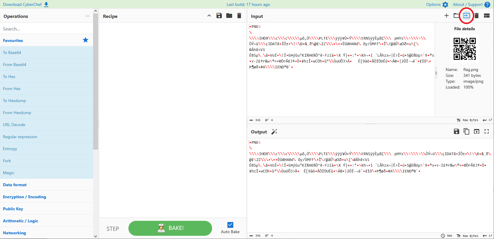
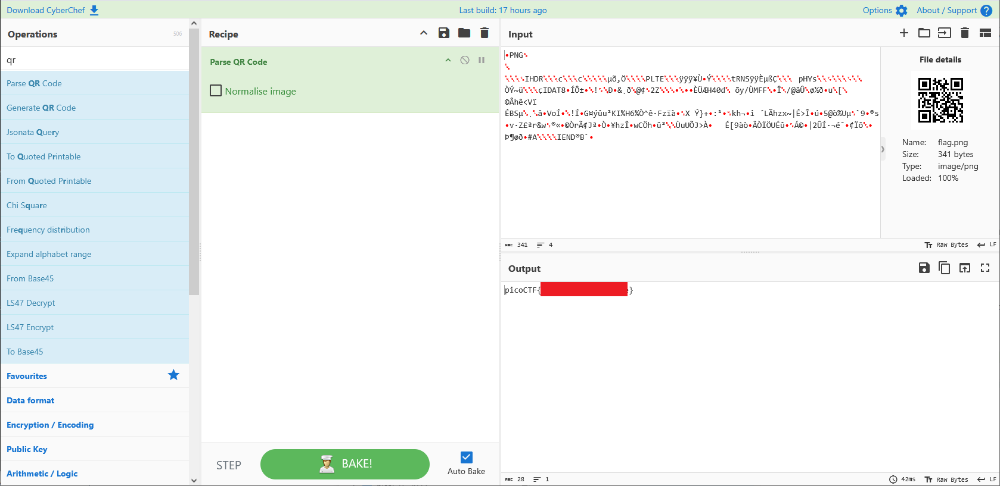

# Scan Surprise

- [Challenge information](#challenge-information)
- [Solution](#solution)
- [References](#references)

## Challenge information

```text
Level: Easy
Points: 50
Tags: picoCTF 2024, Forensics, shell, browser_webshell_solvable, qr_code
Meta Tags: Walkthrough, Walk-through, Write-up, Writeup
Author: JEFFERY JOHN

Description:
I've gotten bored of handing out flags as text. Wouldn't it be cool if they were an image instead?

You can download the challenge files here:
challenge.zip

The same files are accessible via SSH here:
ssh -p 61129 ctf-player@atlas.picoctf.net
Using the password 83dcefb7. Accept the fingerprint with yes, and ls once connected to begin. 
Remember, in a shell, passwords are hidden!

Hints:
1. QR codes are a way of encoding data. While they're most known for storing URLs, 
   they can store other things too.
2. Mobile phones have included native QR code scanners in their cameras since version 8 (Oreo) and iOS 11
3. If you don't have access to a phone, you can also use zbar-tools to convert an image to text
```

Challenge link: [https://learn.cylabacademy.org/library/444](https://learn.cylabacademy.org/library/444)

## Solution

### Unpacking and basic analysis

We start by unpacking the zip-file

```bash
┌──(kali㉿kali)-[/mnt/…/picoCTF/picoCTF_2024/Forensics/Scan_Surprise]
└─$ unzip challenge.zip 
Archive:  challenge.zip
   creating: home/ctf-player/drop-in/
 extracting: home/ctf-player/drop-in/flag.png  

┌──(kali㉿kali)-[/mnt/…/picoCTF/picoCTF_2024/Forensics/Scan_Surprise]
└─$ cd home/ctf-player/drop-in 

┌──(kali㉿kali)-[/mnt/…/Scan_Surprise/home/ctf-player/drop-in]
└─$ file flag.png            
flag.png: PNG image data, 99 x 99, 1-bit colormap, non-interlaced
```

We have a [PNG-file](https://en.wikipedia.org/wiki/PNG) which is a [QR-code](https://en.wikipedia.org/wiki/QR_code).  
Use a tool such as `eog` of `feh` to view it on Linux.



### Get the flag with CyberChef

To decode the QR code we can use [CyberChef](https://gchq.github.io/CyberChef/).

Open the `flag.png` file as input with the icon looking like an arrow pointing into a square.



Then enter `qr` in the Operations search bar and double-click on `Parse QR Code` to add the operation to the Recipe.



### Get the flag with zbar-tools

Alternatively we can use the `zbar-tools` package as described in one of the hints.  
Use `sudo apt install zbar-tools` to install it if needed.

```bash
┌──(kali㉿kali)-[/mnt/…/Scan_Surprise/home/ctf-player/drop-in]
└─$ zbarimg flag.png 
QR-Code:picoCTF{<REDACTED>}
scanned 1 barcode symbols from 1 images in 0.01 seconds
```

For additional information, please see the references below.

## References

- [CyberChef - GitHub](https://github.com/gchq/CyberChef)
- [CyberChef - Homepage](https://gchq.github.io/CyberChef/)
- [feh - Linux manual page](https://linux.die.net/man/1/feh)
- [file - Linux manual page](https://man7.org/linux/man-pages/man1/file.1.html)
- [PNG - Wikipedia](https://en.wikipedia.org/wiki/PNG)
- [QR code - Wikipedia](https://en.wikipedia.org/wiki/QR_code)
- [unzip - Linux manual page](https://linux.die.net/man/1/unzip)
- [zbarimg - Linux manual page](https://linux.die.net/man/1/zbarimg)
