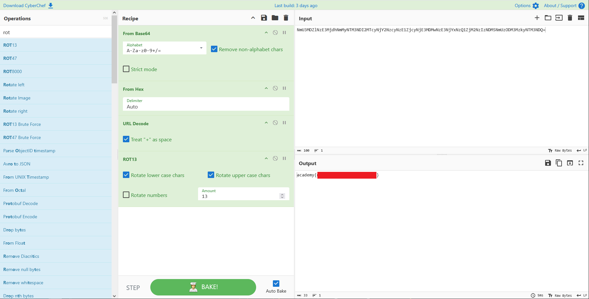

# MultiCode

- [Challenge information](#challenge-information)
- [Solution](#solution)
- [References](#references)

## Challenge information

```text
Level: Easy
Tags: General Skills, picoCTF 2026
Meta Tags: Walkthrough, Walk-through, Write-up, Writeup
Author: Yahaya Meddy

Description:
We intercepted a suspiciously encoded message, but it’s clearly hiding a flag. No encryption, just multiple 
layers of obfuscation. Can you peel back the layers and reveal the truth? Download the message.

Hints:
1. The flag has been wrapped in several layers of common encodings such as ROT13, URL encoding, Hex, 
   and Base64. Can you figure out the order to peel them back?
2. A tool like CyberChef can be interesting.
```

Challenge link: [https://learn.cylabacademy.org/library/710](https://learn.cylabacademy.org/library/710)

## Solution

We start by checking out the encoded message:

```bash
┌──(kali㉿kali)-[/mnt/…/picoCTF/picoCTF_2026/General_Skills/MultiCode]
└─$ cat message.txt 
NmU3MDZlNzE3MjdhNmMyNTM3NDI2MTcyNjY2NzcyNzE1ZjcyNjE3MDMwNzE3NjYxNzQ1ZjM2NzIzNDM5NmUzODM3MzkyNTM3NDQ=
```

The first layer seems to be Base64-encoding.

```bash
┌──(kali㉿kali)-[/mnt/…/picoCTF/picoCTF_2026/General_Skills/MultiCode]
└─$ cat message.txt | base64 -d
6e706e71727a6c2537426172666772715f72617030717661745f367234396e383739253744    
```

And this layer looks like hexadecimal.

```bash
┌──(kali㉿kali)-[/mnt/…/picoCTF/picoCTF_2026/General_Skills/MultiCode]
└─$ cat message.txt | base64 -d | xxd -r -p
npnqrzl%7Barfgrq_rap0qvat_6r49n879%7D   
```

The `%7B` and `%7D` looks like URL-encoding. We can decode them with [url](https://binref.github.io/#refinery.url) from Binary Refinery.

```bash
┌──(kali㉿kali)-[/mnt/…/picoCTF/picoCTF_2026/General_Skills/MultiCode]
└─$ source ~/Python_venvs/Binary_Refinery/bin/activate

┌──(Binary_Refinery)─(kali㉿kali)-[/mnt/…/picoCTF/picoCTF_2026/General_Skills/MultiCode]
└─$ cat message.txt | base64 -d | xxd -r -p | url
npnqrzl{arfgrq_rap0qvat_6r49n879}
```

### Get the flag via command line

The final layer is ROT13-encoding which we can decode with `rot13` from [bsdgames](https://wiki.linuxquestions.org/wiki/BSD_games).

Install it with `sudo apt install bsdgames` if needed.

```bash
┌──(Binary_Refinery)─(kali㉿kali)-[/mnt/…/picoCTF/picoCTF_2026/General_Skills/MultiCode]
└─$ cat message.txt | base64 -d | xxd -r -p | url | rot13
academy{<REDACTED>}
```

### Get the flag via GUI

If you prefer a GUI solution there is [CyberChef](https://gchq.github.io/CyberChef/):



For additional information, please see the references below.

## References

- [base64 - Linux manual page](https://man7.org/linux/man-pages/man1/base64.1.html)
- [Base64 - Wikipedia](https://en.wikipedia.org/wiki/Base64)
- [Binary Refinery - Documentation](https://binref.github.io/)
- [Binary Refinery - GitHub](https://github.com/binref/refinery/)
- [CyberChef - GitHub](https://github.com/gchq/CyberChef)
- [CyberChef - Homepage](https://gchq.github.io/CyberChef/)
- [Hexadecimal - Wikipedia](https://en.wikipedia.org/wiki/Hexadecimal)
- [Percent-encoding - Wikipedia](https://en.wikipedia.org/wiki/Percent-encoding)
- [ROT13 - Wikipedia](https://en.wikipedia.org/wiki/ROT13)
- [xxd - Linux manual page](https://linux.die.net/man/1/xxd)
