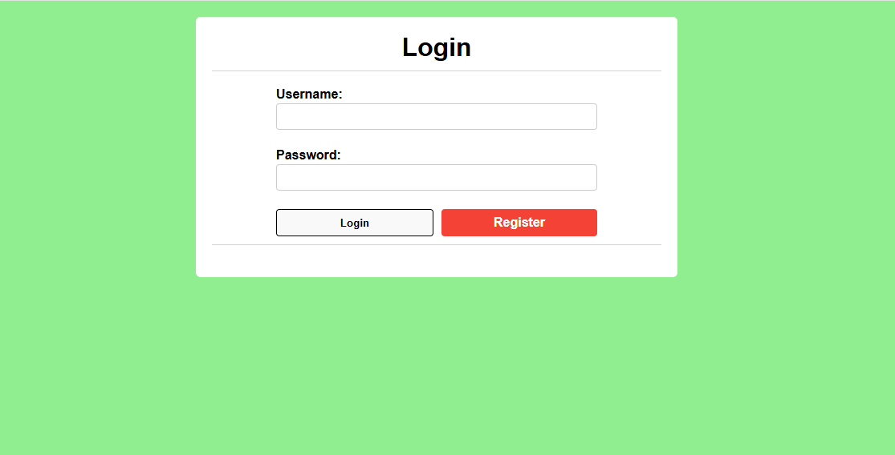
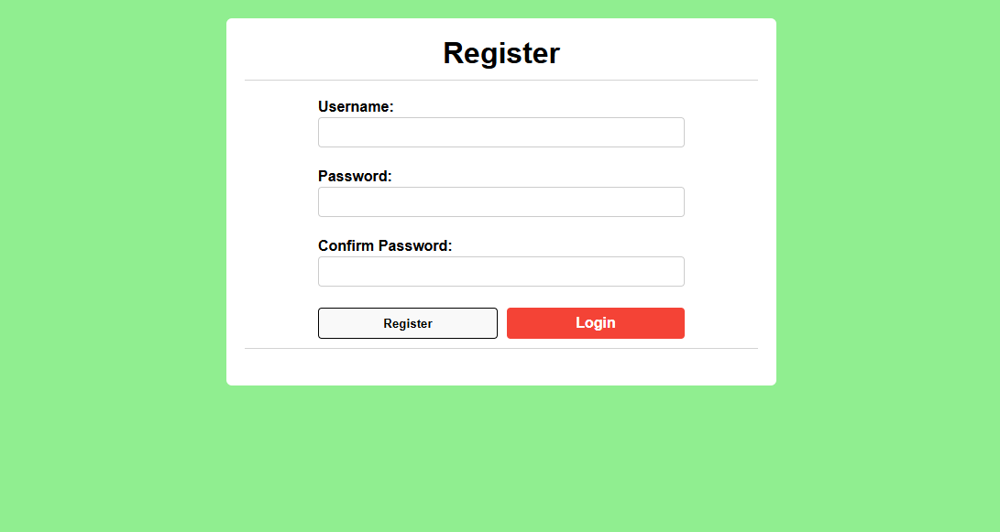
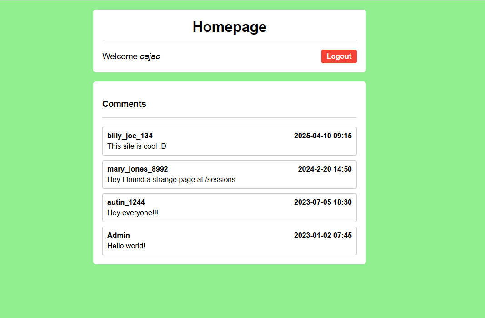
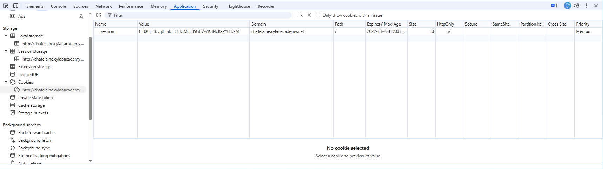
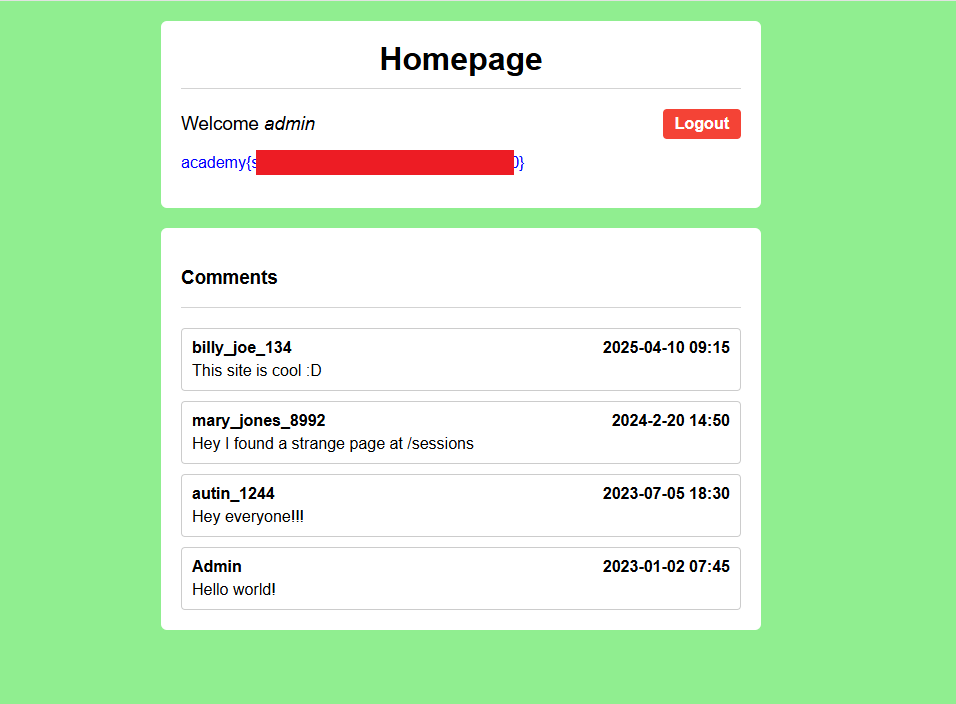

# Old Sessions

- [Challenge information](#challenge-information)
- [Solution](#solution)
- [References](#references)

## Challenge information

```text
Level: Easy
Tags: Web Exploitation, picoCTF 2026
Meta Tags: Walkthrough, Walk-through, Write-up, Writeup
Author: David Gaviria

Description:
Proper session timeout controls are critical for securing user accounts. If a user logs in on a public or 
shared computer but doesn’t explicitly log out (instead simply closing the browser tab), and session 
expiration dates are misconfigured, the session may remain active indefinitely.

This then allows an attacker using the same browser later to access the user’s account without needing 
credentials, exploiting the fact that sessions never expire and remain authenticated. Your friend tells 
you to check out a new social media platform he built a few years ago. Although its still under development, 
he said the site is almost complete. He also mentioned that he hates constantly logging into sites, and 
so has made his page that 'once you login, you never have to log-out again'!

Browse here, and find the flag!

Hints:
1. Do you know how to use the web inspector?
2. Where are cookies stored?
```

Challenge link: [https://learn.cylabacademy.org/library/739](https://learn.cylabacademy.org/library/739)

## Solution

We browse to the web site and see a login portal:



### Register a new user

Since we don't have any credentials, we register a new user:



- Username: `cajac`
- Password: `secret`

After logging in we see a number of messages:



One of the messages mentions a strange page called `/sessions`.

The page contains the stored session cookies:

```text
1) session:Ot2Ln5AR9sHpfZ4MFbxSzzhrmaItCEfWPqBgkwC93Do, {'_permanent': True, 'key': 'admin'}

2) session:EJ0X0H4bvqJLmldEt10GMuL85GhV-ZK3NcKa2YEfDxM, {'_permanent': True, 'key': 'cajac'}
```

To hijack the admin-session we should change our session cookie to the admin one.

Press F12 to start DevTools. Select the `Application` tab and make sure the site is selected under `Cookies` in the menu to the left:



### Get the flag

To get the flag we change our cookie value, press `F5` to reload the page and change the URL to the homepage.



For additional information, please see the references below.

## References

- [DevTools - Chrome Docs](https://developer.chrome.com/docs/devtools/)
- [DevTools - Firefox User Docs](https://firefox-source-docs.mozilla.org/devtools-user/)
- [DevTools - MDN](https://developer.mozilla.org/en-US/docs/Learn_web_development/Howto/Tools_and_setup/What_are_browser_developer_tools)
- [HTTP cookie - Wikipedia](https://en.wikipedia.org/wiki/HTTP_cookie)
